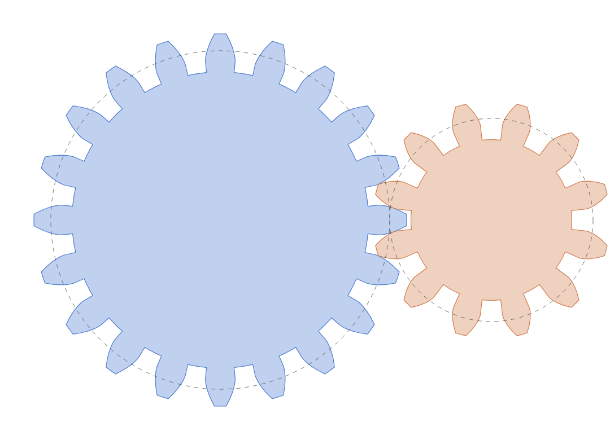

# Gears: a SolidCraft plugin

Makes involute spur gears in SolidCraft. It adds a **Spur gear** entry to the Model ribbon.
You fill in a form, and the plugin computes the tooth profile, then builds it with ordinary
SolidCraft commands: a closed sketch polyline, plus an optional bore circle, and an extrude.
The result is a normal, editable sketch and extrude, so you can modify it later. The whole
run is a single undo step. The plugin needs no file, network or settings access.



## Install

In SolidCraft (desktop), open **Preferences > Plugins > Install plugin…** and pick
`gears-0.1.0.zip`. It asks for no permissions. You can also install it from a script:

```json
[{"command":"plugin.install","params":{"path":"gears-0.1.0.zip"}}]
```

## Inputs (entry `spur`)

| Field | Default | Meaning |
|---|---|---|
| `teeth` | 20 | 6–150 |
| `module` | 2 | Tooth size in mm. Pitch diameter = module × teeth |
| `pressure_angle` | 20 | 14.5, 20 or 25 degrees |
| `thickness` | 10 | Face width (extrude distance) in mm |
| `bore` | 0 | Centre hole diameter in mm. 0 means no hole |
| `backlash` | 0 | Thins each tooth by this much at the pitch circle, in mm |
| `plane` | XY | XY, XZ or YZ |
| `flank_points` | 8 | Points per tooth flank (2–40). More points give a smoother tooth but a heavier sketch |

The plugin returns the pitch, tip, root and base diameters. Two gears with the same module
and pressure angle mesh when their centres are **(z1 + z2) × module / 2** apart.

## Geometry

Standard full-depth teeth:

- addendum = 1 × module
- dedendum = 1.25 × module
- no profile shift

Each flank is an involute of the base circle, approximated by a polyline. When the root
circle lies inside the base circle, the flank continues to the root as a straight radial
line. Root and tip lands are short polyline arcs. Undercut is not modelled: below about 17
teeth at 20°, the plugin returns a warning, and a real cut gear would differ near the root.

## Build

```bash
rustup target add wasm32-unknown-unknown
cargo install wasm-tools
./build.sh          # tests, builds the component, writes gears-0.1.0.zip
```

`host-check/` runs the packaged component inside SolidCraft's real runtime crate
(`craft-plugin-wasm`), using a host that records each command call. It expects a SolidCraft
checkout next to this repository:

```bash
git clone --depth 1 https://github.com/tangency-labs/solidcraft ../solidcraft
cd host-check && cargo run --release
```

`wit/plugin.wit` is copied unchanged from SolidCraft (`crates/craft-plugin/wit/plugin.wit`,
MIT OR Apache-2.0).

## How SolidCraft plugins work (craft:plugin@0.1.0, experimental)

- A plugin is a WebAssembly **component** (not a plain core module) plus `plugin.json`.
- It runs sandboxed: no WASI, no network, and fuel, memory and deadline limits.
- It can only call the SolidCraft commands listed in the manifest's `runtime.commands`.
  These are the same commands MCP clients use. It gets JSON results back.
- `runtime.entries` declares each entry's input schema. SolidCraft draws the form from that
  schema and calls the component's `execute(entry, params)` export.
- A successful call is committed as one undo step. Any error rolls back the whole call.
- Plugins can't keep data between runs yet. The `storage` capability will add that.
  There are no custom panels and no parametric re-run: changing the gear means running
  the plugin again.
